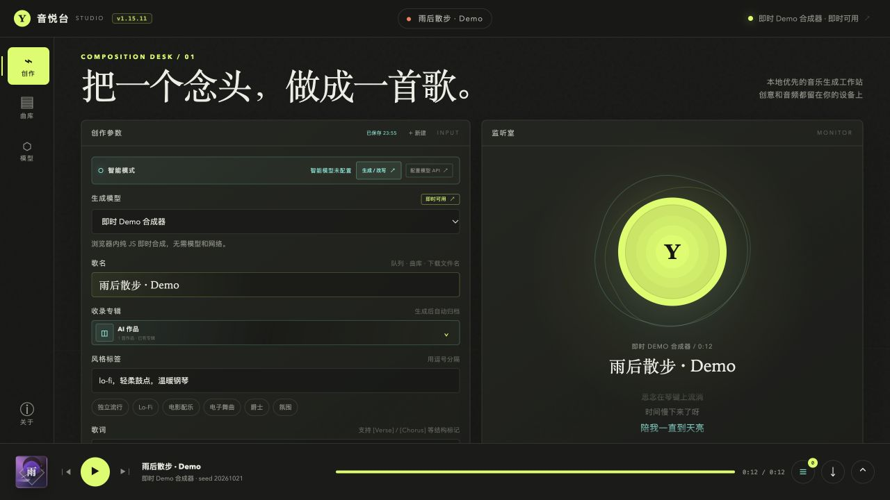
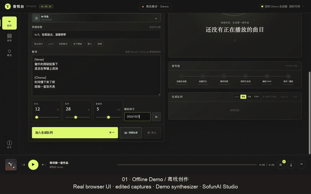

<picture>
  <source media="(prefers-color-scheme: dark)" srcset="assets/brand/sofunai-logo-dark.svg">
  <source media="(prefers-color-scheme: light)" srcset="assets/brand/sofunai-logo-light.svg">
  
</picture>

**Published and maintained by [SofunAI Studio](assets/brand/README.md).**

**[GitHub](https://github.com/KyleZheng8848/yinyuetai)** · **[Releases](https://github.com/KyleZheng8848/yinyuetai/releases)** · [Report a bug](https://github.com/KyleZheng8848/yinyuetai/issues)

**English** | [简体中文](README.zh-CN.md)

# Yinyuetai Studio · 音悦台

**Write, generate, organize and play music in one local-first workspace.** Choose an optional local music model or connect your own API. Try the complete queue → library → player flow with the built-in offline Demo before downloading any model.



[](docs/MEDIA.md)

**[Screenshots and walkthrough](docs/MEDIA.md)** · [Chinese usage guide](docs/USAGE.zh-CN.md)

The preview shows real browser UI operated with Computer Use in an empty, isolated session. It is an edited sequence of sampled screen captures, silent, with bilingual captions. The audio is from the built-in **procedural Demo synthesizer**, not a trained music model or a sung version of the displayed lyrics. Native desktop recording is not included.

## Why try it?

- **One creation desk:** title, style, lyrics, seed and model-specific parameters; submit a queue without losing your next idea.
- **Your choice of engine:** MiniMax Music 3, Stable Audio and ACE-Step integration paths, plus BYOK remote endpoints. Local models download only after you choose to install them.
- **Keep the result useful:** local library, albums, search, playback, audio export and generation parameters alongside each track.
- **Optional writing assistance:** connect Ollama or an OpenAI-compatible LLM to help draft fields; this is separate from audio generation.
- **Start without a key:** offline Demo runs without model weights, credentials or paid API calls.

The app UI is currently primarily **Simplified Chinese**. Both README languages describe the same application; an English interface is not yet implemented.

## Downloads

The first macOS release is being prepared in [GitHub Actions](https://github.com/KyleZheng8848/yinyuetai/actions). Until a verified release is listed in [Releases](https://github.com/KyleZheng8848/yinyuetai/releases), use the source instructions below. Windows/Linux build targets exist, but no verified binary release is provided for those platforms.

## First result, without a model

Use **Node.js 22.14+** and npm. Electron is downloaded by `npm ci`.

```bash
git clone https://github.com/KyleZheng8848/yinyuetai.git
cd yinyuetai
npm ci
npm start
```

1. On the creation desk (**创作台**), select **即时 Demo 合成器** in **生成模型**.
2. Enter a song title and style tags, and choose a short duration, such as 12 seconds.
3. Click **加入生成队列**. Once complete, click **播放**, then open **曲库** to find the saved track.

The Demo validates the workflow. It does not synthesize sung lyrics or represent the quality of optional music models. Browser mode: `npm run web`, then open `http://127.0.0.1:8799/`. Each browser/profile/origin has its own IndexedDB library; changing port or clearing site data changes access to that library. Export important audio before clearing data.

## Local models and your own API

Open **模型中心** to choose a local model, a remote API or an LLM. Local installs require Git, [uv](https://docs.astral.sh/uv/), several GB of downloads, and enough disk space and memory for the selected model. MLX paths require Apple Silicon; an Intel app package does not imply MLX support. Installation shows model-specific licenses and resource guidance. Models are not bundled in this repository or installer.

Remote music generation and LLM assistance send inputs to the endpoints you configure and may incur provider charges. The custom Suno-compatible connector is configurable; it does not imply an official public Suno API. See [the usage guide](docs/USAGE.zh-CN.md) and [third-party notices](THIRD_PARTY_NOTICES.md) for supported paths and licensing boundaries. Actual model inference on all engines/hardware is not covered by source tests or the Demo.

## Data and privacy

Desktop runtime configuration and optional model files live in Electron's user-data runtime directory; browser/server mode defaults to `.runtime/`. The audio library uses IndexedDB in the active app/browser profile. API keys are stored locally by the companion service and are sent only as needed to configured services. Treat runtime directories, browser profiles and audio exports as private; they are not included in the public source snapshot. Local-first describes the local workflow; configured remote generation, downloads and LLM calls use the network.

## Develop and contribute

```bash
npm ci --ignore-scripts
npm test
npm run check:version
```

Tests use mocked services and temporary runtimes. They do not install model weights or call paid providers. To run the desktop app after a script-skipping install, run a normal `npm ci` first.

Start with a reproducible [bug report](https://github.com/KyleZheng8848/yinyuetai/issues), improve a translation, document a tested hardware/model setup, or propose a small focused fix. See [CONTRIBUTING.md](CONTRIBUTING.md). If this helps your workflow, a star helps other creators find it.

For packaging and dual-architecture checks, see [RELEASING.md](docs/RELEASING.md). `npm run dist` builds local artifacts in `release/` with `--publish never`. Optional self-hosted distribution requires your own configuration; it is not part of normal setup.

## License and acknowledgments

Application code is [MIT](LICENSE), © 2026 SofunAI Studio and Yinyuetai contributors. **lamejs / LAME remains LGPL-3.0**; full license texts and replacement/rebuild guidance are in [THIRD_PARTY_NOTICES.md](THIRD_PARTY_NOTICES.md). Optional model code, weights, APIs and generated content retain their respective terms; this repository's MIT license does not relicense them.

[Codex](https://developers.openai.com/codex/) assisted with open-source preparation, documentation and verification. AI tools are acknowledged here rather than added as fictional GitHub contributors. Cursor can be used as a contributor's editor; no Cursor authorship is claimed without evidence of its use.
