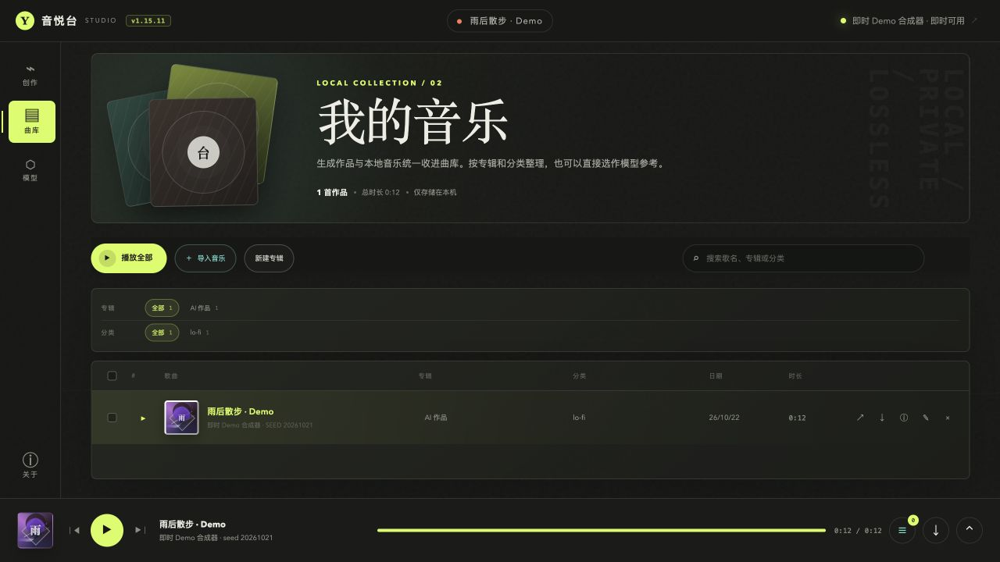
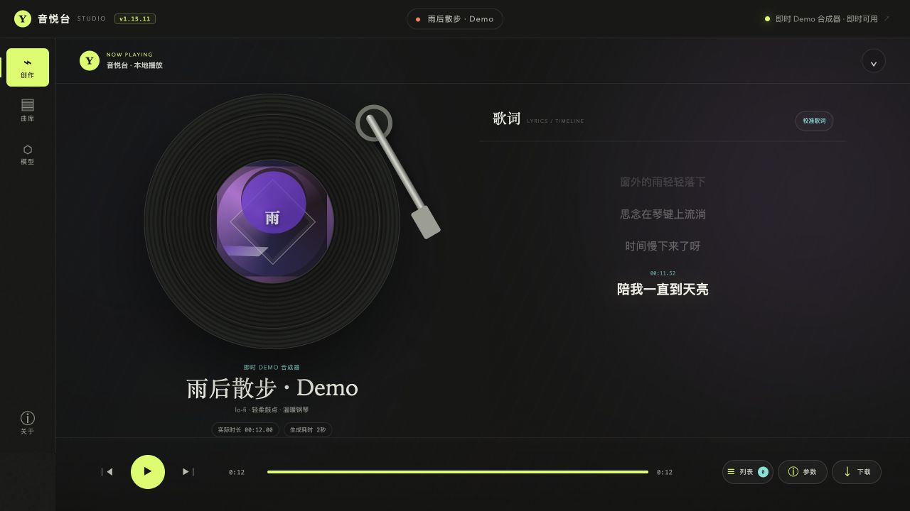
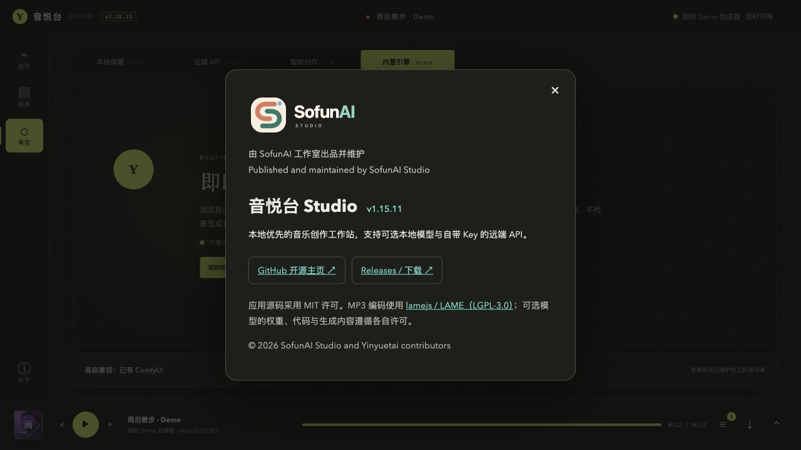

# Screenshots and walkthrough / 界面与演示

音悦台 Studio **1.15.11**，2026-10-22。截图与采样画面来自真实应用的浏览器模式，使用空白临时运行目录和内置 Demo，无个人配置、付费 API 调用或模型安装。

Yinyuetai Studio 1.15.11. Captured from the actual browser UI in an isolated session, using the built-in procedural Demo. No paid generation or model inference is represented.

演示是实际 Computer Use 操作过程的采样画面剪辑，有双语字幕，无旁白、无配乐；包含离线创作、生成完成、试听、曲库、Demo 说明和关于页。采样间有剪辑，未展示原生菜单或连续桌面录像。Demo 不演唱所显示歌词，不用于评价音乐模型音质。

The walkthrough is a silent edited sequence of sampled real browser captures with bilingual captions. It covers offline composition, generation, playback, library and About. Cuts occur between sampled segments. It is not a continuous native desktop recording. The Demo does not sing the displayed lyrics and is not a music-model quality sample.

[Watch / 下载 MP4](https://github.com/KyleZheng8848/yinyuetai/releases/download/v1.15.11/yinyuetai-browser-walkthrough-1.15.11.mp4)
